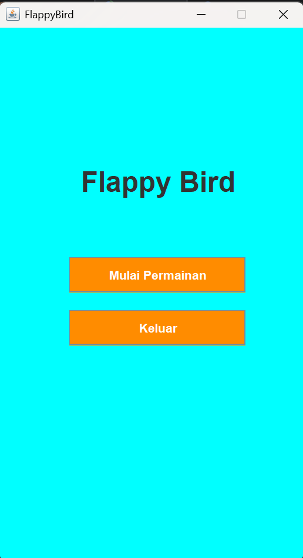
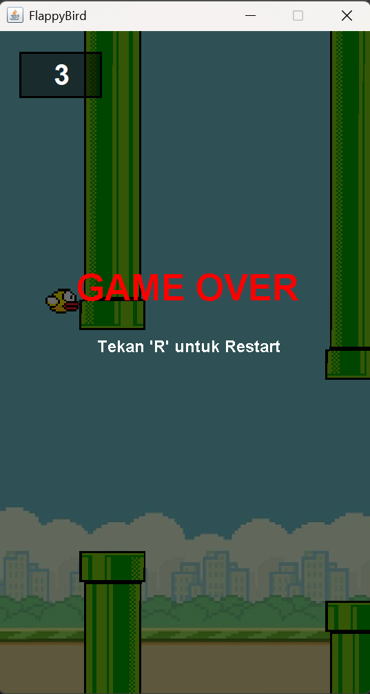
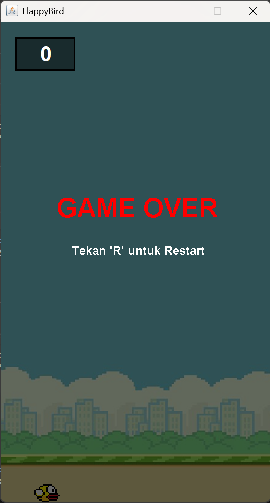

# TP 6 DPBO C1 
Flappy Peksi Java Swing  

# Janji Suci
Saya <strong>Faiz Muhammad Ghazali</strong> dengan <strong>NIM 2504531</strong> mengerjakan tugas pembuatan game Flappy Bird menggunakan Java Swing untuk keberkahan-Nya maka saya tidak melakukan kecurangan seperti yang telah dispesifikasikan. Aamiin.

## 1. Desain Program (Arsitektur Kelas)

Program ini menggunakan pola arsitektur **MVC sederhana (Model-View-Controller)** yang disesuaikan untuk implementasi Java Swing:

*   **`App.java` (Entry Point):** Menginisialisasi `JFrame` utama, menampilkan *Main Menu* interaktif dengan tombol "Mulai Permainan" dan "Keluar" (bernuansa oranye), serta menginisialisasi objek `Logic` dan `View` saat permainan dimulai.
*   **`Logic.java` (Controller & Game Loop):** Mengimplementasikan `ActionListener` dan `KeyListener`. Mengatur *state* permainan (skor, `gameOver`, `isWaitingToStart`), gravitasi (`gravity`), kecepatan pipa (`pipeVelocityX`), posisi pemain, deteksi tabrakan, serta sistem tingkat kesulitan berbasis gelombang (`updateDifficulty()`). `Timer` berfungsi sebagai *game loop* (60 FPS) dan *spawner* pipa (`pipesCooldown`).
*   **`View.java` (View):** Mengimplementasikan `JPanel`. Bertanggung jawab untuk merender visual latar belakang (`backgroundbaru.png`), `Player`, `Pipe`, label skor ber-border hitam, label *wave*, serta layar *Game Over* dengan efek redup dan teks merah.
*   **`Player.java` (Model):** Menyimpan state burung (posisi `posX`, `posY`, `width`, `height`, `image`, `velocityY`). Memiliki method `getBounds()` untuk mendeteksi hitbox tabrakan secara adil.
*   **`Pipe.java` (Model):** Menyimpan state pipa (posisi, ukuran, `image`, `velocityX`, `passed`). Memiliki method `getBounds()` untuk hitbox rintangan.
*   **`Sound.java` (Utility):** Mengelola pemutaran audio menggunakan `javax.sound.sampled.Clip` dengan format `.wav` (`sfx_wing.wav`, `sfx_point.wav`, `sfx_die.wav`).

## 2. Penjelasan Alur Permainan

1. **Inisialisasi & Menu:** Saat program dijalankan, jendela utama menampilkan *Main Menu*. Ketika tombol "Mulai Permainan" ditekan, panel game dimuat.
2. **Menunggu Aksi:** Game berada pada status menunggu (`isWaitingToStart = true`). Pipa tidak bergerak dan burung diam. Layar menampilkan teks "Tekan SPASI untuk Mulai".
3. **Mulai Bermain:** 
   - Pemain menekan **SPASI**. Status berubah, burung melompat (`velocityY = -10`), dan suara kepak sayap diputar.
   - `move()` mulai bekerja: menerapkan gravitasi (`velocityY += gravity`), menggerakkan pipa ke kiri, serta mendeteksi batas layar dan tabrakan.
   - `pipesCooldown` (Timer) secara berkala memanggil `placePipes()` untuk memunculkan pasangan pipa atas dan bawah.
4. **Skor & Sistem Wave (Kesulitan Dinamis):**
   - Jika `player` melewati pipa dan belum ditandai `passed`, skor bertambah, suara poin diputar, dan `updateDifficulty()` dipanggil.
   - Tingkat kesulitan meningkat berdasarkan *wave* (setiap kelipatan 5 skor). *Wave* yang semakin tinggi akan mempersempit celah pipa (`openingSpace`) dan mempercepat kemunculan pipa baru (`pipesCooldown.setDelay`).
5. **Game Over:**
   - Jika burung menabrak pipa, menyentuh batas atas, atau jatuh ke batas bawah jendela, maka `gameOver = true` dan suara mati diputar.
   - Pergerakan berhenti, dan `View` menampilkan latar belakang redup (transparan gelap) dengan teks "GAME OVER" berwarna merah serta instruksi untuk restart.
6. **Restart:** Jika pemain menekan tombol **'R'** saat `gameOver == true`, permainan mereset posisi burung, membersihkan pipa, mengembalikan skor ke nol, dan masuk kembali ke status menunggu tekan **SPASI**.

## 3. Mekanisme Deteksi Tabrakan (Hitbox)

Deteksi tabrakan menggunakan method `getBounds()` yang mengembalikan objek `Rectangle`:
*   **`Player.getBounds()`:** Mengembalikan kotak area dengan margin 2 piksel di setiap sisi (`posX+2`, `posY+2`, `width-4`, `height-4`) agar deteksi tabrakan terasa lebih adil bagi pemain.
*   **`Pipe.getBounds()`:** Mengembalikan kotak area presisi sesuai ukuran gambar pipa.
*   **Pengecekan:** Menggunakan `player.getBounds().intersects(pipe.getBounds())` di dalam perulangan pipa pada method `move()`.

## 4. Sistem Kesulitan (Wave Scaling)

Tingkat kesulitan meningkat secara dinamis berdasarkan nilai `wave` (`score / 5`):
*   **Celah Pipa (`openingSpace`):** Mengikuti ukuran dinamis berdasarkan tingkat *wave* (minimum selebar 100px).
*   **Jarak Antar Pipa (`pipesCooldown.setDelay`):** Berkurang secara bertahap seiring bertambahnya *wave* hingga batas minimum 900ms, membuat pipa muncul lebih rapat.

## 5. Catatan Teknis

*   **Game Loop:** Menggunakan `javax.swing.Timer` dengan interval `1000 / 60` (~60 FPS).
*   **Aset Gambar:** Dimuat menggunakan `ImageIcon` dan `URL` dari folder `assets` (`bird.png`, `backgroundbaru.png`, `upperPipe.png`, `lowerPipe.png`).
*   **Aset Suara:** Dimuat menggunakan `AudioSystem` dan `BufferedInputStream` dari folder `assets` untuk berkas berformat `.wav` (`sfx_wing.wav`, `sfx_point.wav`, `sfx_die.wav`).
*   **Manajemen Komponen Tampilan:** Menggunakan `JLabel` berlatar belakang hitam transparan dengan *border* garis hitam untuk memperjelas visibilitas teks skor dan *wave*.

---
# Struktur File

```

Main
├── FlappyBird/
│   └── src/
│       ├── App.java
│       ├── Logic.java
│       ├── View.java
│       ├── Player.java
│       ├── Pipe.java
│       └── assets/
│           ├── bird.png
│           ├── lowerPipe.png
│           ├── upperPipe.png
│           ├── background.png
│           ├── sfx_wing.wav
│           ├── sfx_point.wav
│           └── sfx_die.wav
│
└── README.md

```
# Penjelasan & Fitur Utama

Program ini menerapkan konsep Pemrograman Berorientasi Objek (**OOP**) dan pengembangan antarmuka grafis menggunakan **Java Swing** dengan studi kasus game arkade klasik **Flappy Bird**.

**Fitur & Ketentuan Permainan:**
1. **Main Menu:** Menu awal dengan tombol "Mulai Permainan" dan "Keluar" bernuansa oranye yang elegan.
2. **Kontrol & Fisika Permainan:** Burung dikendalikan menggunakan tombol **Spasi** untuk melompat ke atas, dipengaruhi oleh percepatan gravitasi secara terus-menerus.
3. **Sistem Skor & Kesulitan Dinamis:** 
   - Skor bertambah setiap kali pemain berhasil melewati pasangan pipa.
   - Tingkat kesulitan otomatis meningkat (celah pipa menyempit dan jeda kemunculan pipa lebih cepat) ketika skor melewati batas tertentu (skor $\ge 20$ dan $\ge 40$).
4. **Game Over & Fitur Restart:** 
   - Permainan otomatis berhenti (*Game Over*) ketika burung menabrak pipa atau jatuh hingga batas bawah layar (`JFrame`).
   - Layar *Game Over* dilengkapi efek latar belakang redup (transparan gelap) dan teks utama berwarna merah.
   - Pemain dapat menekan tombol **'R'** untuk mereset permainan ke kondisi awal, di mana burung akan menunggu hingga tombol **Spasi** ditekan kembali untuk memulai penerbangan.
5. **Audio & Sound Effects (SFX):** 
   - Dilengkapi efek suara berbasis `.wav` untuk aksi kepak sayap (`sfx_wing.wav`), penambahan skor (`sfx_point.wav`), dan suara saat menabrak/mati (`sfx_die.wav`).

## 🔊 PENGGUNAAN AUDIO (.WAV)
- Program menggunakan `AudioSystem` dan `Clip` yang dibungkus dengan `BufferedInputStream` untuk memastikan pemutaran berkas suara `sfx_wing.wav`, `sfx_point.wav`, dan `sfx_die.wav` berjalan lancar langsung dari folder `assets/`.

# Dokumentasi

## 1. Menu
<br>


## 2. Gem Oper
*Ada beberapa Tipe Game Over*
1. Kejedot Pipa


2. Kepeleset


## 3. Hidden Challenge
*Ada Fitur Tersembunyi, ketika sudah menyentuh skor 20, maka kesulitan meningkat*


## 4. Menu Tekan Spasi
*Jika ingin memulai permainan, tekan spasi*


# Video Permainan


```